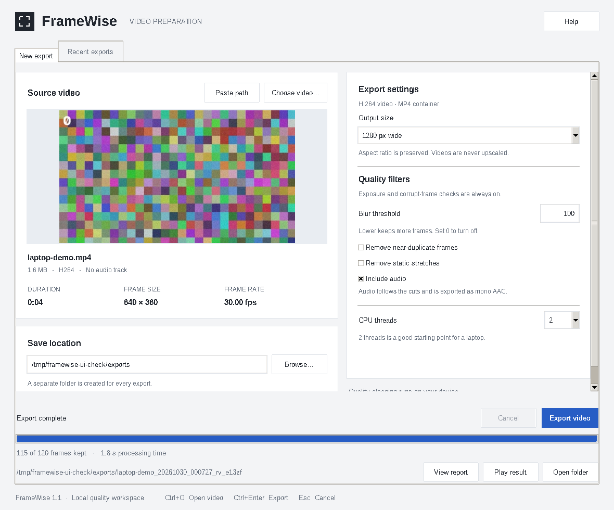

# FrameWise

A native desktop workspace for cleaning video quality and preparing usable footage.
FrameWise previews the source, filters unwanted frames, cuts audio to match, and
saves an MP4 with a readable export report. Processing stays on your computer.



## Laptop UI

Launch the native desktop interface from this project folder:

```bash
bash run_ui.sh
```

On a fresh checkout, run `bash scripts/setup_laptop.sh` first. It creates a
project-local `.venv`, choosing Python 3.11+ with Tkinter (including Anaconda
when available), then installs the project. On Linux, a Python Tk package
is needed if none of your Python installations includes Tkinter.

Select **Choose video** or **Paste path**, choose the **Save location**, then select
**Export video**. The workspace shows a source preview, duration, dimensions,
frame rate, file size and audio availability. Progress and cancellation remain
accessible on smaller windows; settings can be scrolled when needed.

After export, use **Play result**, **Open folder**, or **View report**. The
**Recent exports** tab keeps the last 20 completed exports across app restarts.
Settings and diagnostic logs are stored locally in `.framewise/`, which is
excluded from Git and Docker builds. Shortcuts: `Ctrl+O` opens a video,
`Ctrl+Enter` starts an export, and `Esc` cancels the current export.

Each run creates a separate folder containing:

- `cleaned.mp4`: H.264 video, with the first audio track cut to match retained
  frames when audio preservation is selected. Audio is converted to mono AAC.
- `frames.jsonl`: one quality decision per decoded frame.
- `report.json`: settings, counts, drop reasons, timing, and run status.

The laptop preset uses two processing threads, a 1280-pixel width cap, a fast
H.264 preset, and streaming processing with no intermediate MCAP or JPEG
round trip. Select **Original size** to retain source resolution
(H.264 requires even dimensions). Quality analysis remains at 640 pixels wide.
Duplicate and static-stretch removal are optional; enabling static removal
adds optical flow computation and a 30-frame decision buffer. A blur
threshold of `0` disables blur removal; lower values keep more frames.

**This mode performs CPU quality checks only.** It checks corruption,
exposure, blur, and optionally duplicates/static stretches. It does not run
child, phone, activity, pose, hand, or depth models, does not produce MCAP,
and does not apply the full pipeline's temporal smoothing. Retained frames
play back consecutively at the source's average frame rate. Variable-frame-rate
inputs are normalized to that rate. Audio is selected by source frame timestamps;
unavailable samples are padded with silence. Other audio tracks and subtitles
are not exported.

If every frame is rejected, only the reports are saved. Cancelled or failed
runs retain their status report and partial audit, and remove partial MP4 files.
The input video is never overwritten.

The same CPU mode is available without the UI:

```bash
.venv/bin/pap clean /path/to/video.mp4 --out /path/to/output
# Optional: --max-width 0 --blur-threshold 50 --remove-duplicates --remove-idle --no-audio
```

The existing `pap run --backend tensorrt` cloud/AI path remains available
with its required GPU engines. `pap run` defaults to the scripted fake
backend, which simulates detections for testing.

See [the laptop analysis](LAPTOP_ANALYSIS.md) for measured resource use and
the design decisions behind this mode. See [the release checks](VALIDATION.md)
for test coverage, build verification and known limitations.

## Development checks

```bash
source .venv/bin/activate
python -m pip install -e '.[dev]'
bash scripts/compile_proto.sh
ruff check src tests
mypy src/physical_ai_pipeline
python -m pytest
```

Native UI tests use an available desktop display. On a headless Linux machine,
run `xvfb-run -a python -m pytest` after installing Xvfb and Tkinter. GitHub
Actions runs lint, type checks, processing tests, native UI tests and a wheel
build on Python 3.11 and 3.13. Those jobs execute when the workflow is pushed.

After installation, `framewise` or `pap-ui` launches the desktop app. The
module command is `python -m physical_ai_pipeline.desktop`.

## Cloud pipeline

GCP cloud-native video cleaning for Physical AI training data: raw sessions
land in `gs://project-raw/`, a GKE worker on an NVIDIA L4 Spot node filters
them through four tiers, and each session becomes one timestamp-synchronised,
Protobuf-encoded `.mcap`, a plain `session.mp4` of the kept frames, and a
`lineage.json`.

```
GCS OBJECT_FINALIZE ──► Pub/Sub ──► GKE worker (1 x L4 per pod)
                                     │
   PyAV decode (thread) ─► Tier 1 metrics (thread pool) ─► Tier 1 decisions (fail fast)
                                     │ survivors
                                     ▼
                     Tier 2 batched TensorRT (16/32): YOLOv8n, YOLOv8n-pose, hands, [depth]
                     + InsightFace SCRFD/genderage on the 15-frame schedule / person-change
                                     │
                     Tier 3: child 2-s buffer ─► phone ─► off-task ─► fake work
                                     │  (decision lag 60 frames)
                     Tier 4: gap fill + island removal ─► grasp state machine
                                     │
                     MCAP (zstd, indexed) + session.mp4 + lineage.json ─► gs://project-clean/sessions/<id>/
                     frame_audit_log ─► BigQuery
```

## Layout

| Path | What |
|---|---|
| `proto/physical_ai.proto` | All pipeline message schemas (`physical_ai.v1`) |
| `proto/foxglove/foxglove.proto` | Foxglove well-known image schemas (CompressedImage, RawImage, ImageAnnotations) |
| `scripts/compile_proto.sh` | `protoc` (or grpcio-tools) → `src/physical_ai_pipeline/proto_gen/` |
| `src/physical_ai_pipeline/config.py` | Pydantic models for every threshold (YAML/JSON + `PAP_*` env overrides) |
| `filters/base.py` | `FilterBase` with `SHADOW` / `SOFT` / `HARD` modes, `FilterChain` |
| `filters/tier1/` | decode/corruption, luminance, Laplacian blur, pHash duplicate, Farneback idle |
| `inference/` | TensorRT engine wrapper, L4 backend, NumPy pre/post-processing, batched runner, scripted fake backend |
| `inference/export/` | YOLO → ONNX, InsightFace fetch, ONNX → TensorRT FP16/INT8 builder with entropy calibrator |
| `filters/tier3/` | child detector + 2-second buffer, phone usage, off-task, fake work |
| `postprocess/` | streaming temporal smoother, grasp interaction state machine |
| `output/` | MCAP writer, MP4 export (`mp4_export.py`), drop-log aggregation, proto conversion, `lineage.json` |
| `pipeline.py` | bounded-memory session orchestrator |
| `cloud/` | Pub/Sub worker, GCS processor, BigQuery sink, engine sync |
| `verify.py`, `tools/verify_mcap.py` | MCAP verification (Foxglove loadability + privacy invariants) |
| `cli.py` | `pap synth / run / verify / bench / worker` |
| `deploy/` | Dockerfile, GKE manifests (L4 Spot, HPA on Pub/Sub backlog), engine build Job, BigQuery schema, GCP setup script |

## Quick start (CPU only, no models)

```bash
pip install grpcio-tools && ./scripts/compile_proto.sh
pip install -e ".[dev]"
pytest                                   # 147 tests, synthetic frames, ~25 s

pap synth demo.mp4 --frames 600          # synthetic video + fake-model script
pap run demo.mp4 --out out --fake-script demo.script.json --whitelist cup
pap verify out/session.mcap
pap bench --width 1920 --height 1080     # Tier 1 cost per frame
```

`pap run` writes `out/session.mcap`, `out/session.mp4`, `out/lineage.json` and
`out/frame_audit_log.jsonl` (the rows the worker streams to BigQuery). The
demo script makes a child walk in on a frame that is not on the 15-frame grid
(caught by the person-change override), and a phone call near the ear.

## Child detection rule

* Checks run on frames 0, 15, 30, … If Tier 1 removed a scheduled frame, the
  check moves to the next frame that reaches the GPU.
* Person-change override: when the YOLO person count differs from the previous
  GPU frame, that frame gets an out-of-cycle check.
* A face with age < 18 and confidence > 0.85 at `F_k` drops
  `[F_k − 30, F_k + 30]` clamped to `[0, total_frames − 1]` (61 frames).
  Overlapping or touching ranges merge into one block (one `DropEvent` with
  all anchor frames).
* Scheduled frames inside an active exclusion are still checked, so a child
  who stays extends the block.
* Pixel buffers of excluded frames are freed as soon as the exclusion is
  known, and frames that arrive later inside the buffer are freed on arrival
  (a frame that still owes its own scheduled check keeps pixels only until
  that check runs).
* Face boxes, crops, embeddings and ages never leave the decision call: they
  are not on `FrameRecord`, not in any proto (the verifier and a unit test
  reject schemas with such fields), not logged. BigQuery gets one row per
  detection: `reason=CHILD_DETECTED`, `anchor_frame`, `dropped_range`.
* The child filter is pinned to `HARD` and cannot be disabled (config
  validation error). The smoother never restores child or decode drops.

## MP4 output

Alongside the MCAP, each session also produces `session.mp4` (H.264, yuv420p,
CRF 20) containing only the kept frames, uploaded to the same
`sessions/<id>/` folder.

* It is generated from the finished MCAP (`/camera/image_compressed`), so the
  pipeline and the MCAP are unchanged.
* Timing is set by `output.mp4_timing`. `continuous` (default) plays the kept
  frames back to back at the source frame rate, so dropped stretches are cut
  out and the video has no freezes (it is shorter than the source).
  `original` keeps each frame's original timestamp (variable frame rate):
  dropped stretches hold the previous frame and the video stays time-aligned
  with every MCAP channel.
* The video has no box or keypoint overlays (those live in
  `/camera/annotations`) and `lineage.json` does not record an MP4 hash.
* Disable with `output.write_mp4: false` (default `true`). The Docker image
  needs an FFmpeg build with `libx264`; PyAV's wheels include it.

## IMU and audio sync

A session can come with companion files named after the video:
`sample.mp4` (video, may carry its own audio), `sample.aac` (audio) and
`sample.txt` (IMU, one JSON object per line: `t_us`, `acc[3]`, `gyro[3]`).

```bash
pap run sample.mp4 --out out        # picks up sample.txt / sample.aac next to it
pap run sample.mp4 --out out --imu other.txt --audio other.aac
```

Everything is cut to the frames that were **kept**; stretches dropped by any
filter (child-exclusion blocks included) are removed from the audio and IMU
too, so all outputs line up with the output video:

| Output | Content |
|---|---|
| `session.mp4` | kept frames **plus the cut audio track** |
| `session.aac` | the cut audio on its own (the encoder adds ~0.2 s of padding) |
| `session.imu.jsonl` | IMU rows inside kept frames; original fields plus `t_out_us` (position in the output video) |

* If no `.aac` is given, the video's own audio track is used. No `.txt`: no IMU output.
* `t_us` is a device clock, so IMU time is taken relative to its first sample
  and treated as video time 0. Shift with `output.imu_offset_s` if they differ.
* With `output.mp4_timing: continuous` (default) segments are concatenated;
  with `original` IMU keeps source time and dropped audio becomes silence.
* On GCS, upload `<stem>.txt` / `<stem>.aac` next to the video **before** the
  video: the worker is triggered by the video upload and reads companions then.
* The MCAP is unchanged and carries no IMU or audio channel.

## MCAP channels

| Topic | Schema |
|---|---|
| `/camera/image_compressed` | `foxglove.CompressedImage` (JPEG) |
| `/camera/annotations` | `foxglove.ImageAnnotations` (boxes, keypoints, labels) |
| `/camera/depth` | `foxglove.RawImage` `16UC1` (only when depth is enabled) |
| `/detections` | `physical_ai.v1.FrameDetections` |
| `/quality` | `physical_ai.v1.FrameQuality` |
| `/actions` | `physical_ai.v1.ActionSegment` |
| `/pipeline/drop_log` | `physical_ai.v1.DropEvent` |
| `/session/metadata` | `physical_ai.v1.SessionMetadata` |

All messages use `log_time = publish_time = session_start + frame PTS`.
Image channels use Foxglove's own schema names so the Image panel renders them
and overlays `/camera/annotations` without configuration.

## Deploying on GKE

1. `deploy/scripts/setup_gcp.sh` (review first): Pub/Sub notification on
   `gs://project-raw`, subscription with dead-letter, partitioned BigQuery
   `frame_audit_log`, `g2-standard-8` L4 Spot node pool scaling to zero,
   Workload Identity.
2. Build and push the image: `docker build --build-arg GIT_COMMIT=$(git rev-parse HEAD) -t REGION-docker.pkg.dev/PROJECT_ID/pap/worker:SHA .`
3. Export models on any machine with the `export` extra
   (`python -m physical_ai_pipeline.inference.export.export_onnx …`,
   `… fetch_insightface …`), upload ONNX + calibration frames to
   `gs://project-models/{onnx,calib}/`, then run
   `deploy/gke/engine-build-job.yaml` on an L4 to build engines with the
   image's TensorRT version.
4. Apply `deploy/gke/{namespace,configmap,worker-deployment,hpa}.yaml`
   (replace `PROJECT_ID`, `REGION`, `GIT_SHA`).

Uploads may set `x-goog-meta-capture-start` (RFC 3339 or epoch ms) and
`x-goog-meta-task-whitelist` (comma-separated COCO classes) on the object.

## Interpretation choices

* **Filter modes.** `SOFT` drops but lets the smoother fill ≤ 2-frame gaps;
  `HARD` is permanent; `SHADOW` only logs (aggregated into audit rows with
  `filter_mode=SHADOW`). Defaults: decode and child `HARD`, the rest `SOFT`.
* **Duplicate / idle** compare each frame with the previous *decoded* frame,
  so their measurements can run on a thread pool ahead of the sequential
  decisions. Idle runs and fake-work runs are dropped retroactively once they
  reach 30 / 60 frames.
* **Phone usage.** IoU between a box and a point is undefined, so wrist/ear
  keypoints become squares of side `0.12 × person height`; hand boxes count as
  wrist regions.
* **Child confidence** is the SCRFD face-detection score (the age head is a
  regression with no confidence).
* **Frames restored by gap filling** were removed in Tier 1, so they carry no
  detections in `/detections`.
* **Islands** shorter than 30 frames at the session edges are dropped too.

## What was and was not verified

Verified in this repository (CPU sandbox, Python 3.13):

* 147 unit/integration tests pass, including the exact 61-frame window,
  clamping at both ends, merging, the person-change override, deferred checks,
  immediate pixel release, the absence of face data in every output, the
  streaming smoother against an offline reference on 60 random sequences, and
  full GCS → MCAP → lineage → audit runs against a local object store.
* Every MCAP produced in tests passes `verify_mcap`: indexed summary, protobuf
  schemas embedded, Foxglove schema names, all messages decode, monotonic
  timestamps, JPEGs decode, counts agree, no kept frame inside a child block.
  The verifier found and fixed two real ordering/flush bugs during development.
* `mypy --strict` and `ruff` are clean (generated proto code excluded).

Not verified (no GPU or cloud access in the build environment):

* **TensorRT and models.** `trt_engine.py`, `tensorrt_backend.py`,
  `build_engine.py`, `calibrator.py` and the export scripts have never run.
  The NumPy pre/post-processing they use is unit-tested on synthetic tensors,
  but output tensor order and layouts from real engines (especially SCRFD's
  nine outputs and the hand-pose model) must be checked on an L4. INT8 uses
  TensorRT's implicit calibrator, which is deprecated in TensorRT 10 (still
  functional); NVIDIA ModelOpt explicit quantisation is the successor.
* **Foxglove Studio itself** was not opened; loadability is checked
  structurally with the `mcap` reader the way Foxglove reads files.
* **ROS 2 / LeRobot.** The files are standard MCAP, so `ros2 bag info` and the
  `mcap` CLI can read them, but `ros2 bag play` cannot deserialise Protobuf
  channels as ROS messages, and there is no LeRobot dataset exporter here.
  Both would need a converter.
* **GCP.** The worker, BigQuery sink, manifests and setup script were not run
  against a real project. The worker logic is tested with fakes.
* **Throughput target.** Measured on the 4-vCPU sandbox with fake models:
  Tier 1 costs 26 ms/frame at 1080p inline and 8.4 ms/frame with 4 threads
  (the < 1 ms target is not met on this CPU; Farneback dominates), and a full
  1080p session runs at ~41 frames/s end to end with ~1.1 GB peak RSS.
  150 h/week at 30 fps needs ~225 frames/s for a 20-hour budget, so the CPU
  side (decode, Tier 1, JPEG) is the bottleneck, not the L4. Closing the gap
  likely needs NVDEC decoding, nvJPEG encoding, a larger CPU shape
  (g2-standard-16/24) or several pods; none of that is implemented yet.
